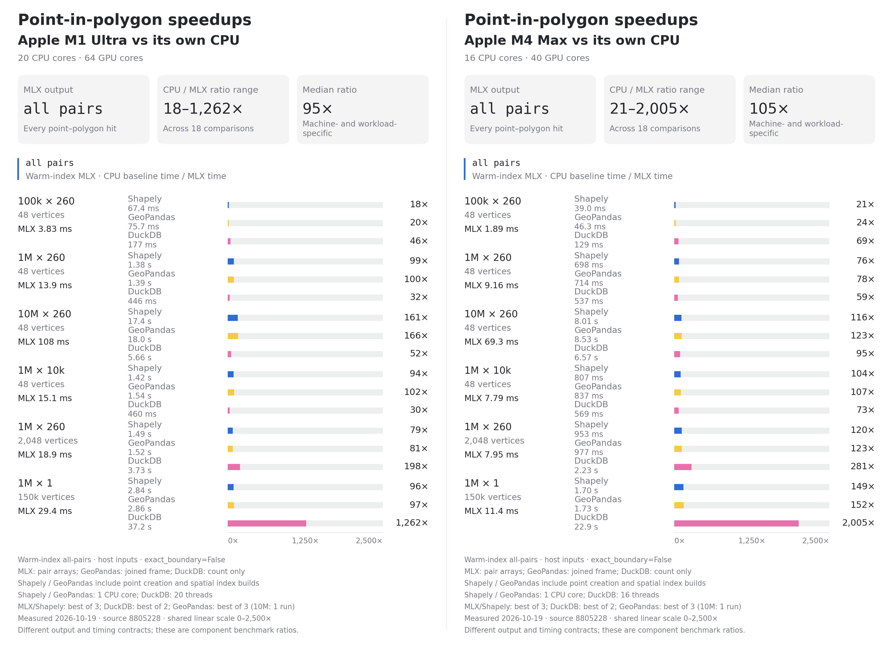

# mlx-geospatial

Fast point-in-polygon queries, spatial joins, and great-circle distances on
Apple silicon, powered by [MLX](https://github.com/ml-explore/mlx).

Use it to assign GPS points to zones, find nearby places, or build spatial
features for an MLX model. It accepts NumPy and Shapely data and can keep
query results as MLX arrays for further GPU processing.

## Install

```bash
pip install mlx-geospatial
```

Requires an Apple silicon Mac, Python 3.10+, and MLX 0.32.0+.
NumPy and Shapely are installed automatically. For GeoPandas support:

```bash
pip install "mlx-geospatial[geo]"
```

## Quickstart

Find which polygon contains each point:

```python
import numpy as np
from shapely.geometry import box
import mlx_geospatial as ms

# Coordinates are (longitude, latitude). Keep host coordinates in float64.
points = np.array([
    [-74.00, 40.72],
    [-73.98, 40.75],
    [-73.90, 40.80],
])
zones = [
    box(-74.02, 40.70, -73.99, 40.74),
    box(-74.00, 40.73, -73.96, 40.78),
]

labels = ms.point_in_polygon(points, zones)
print(labels)  # [ 0  1 -1]
```

Each label is a polygon's position in `zones`; `-1` means no match.
If polygons overlap, the lowest polygon index wins. To get every match:

```python
point_ids, polygon_ids = ms.point_in_polygon(points, zones, all_matches=True)
```

Containment returns NumPy arrays for host inputs and MLX arrays for MLX inputs.
Points very close to polygon edges need extra care; see [accuracy](#accuracy-and-limits).

### Reuse polygons and points

Build the polygon set and index once when querying the same zones repeatedly:

```python
polygons = ms.PolygonSet(zones)
index = ms.GridIndex(polygons)
labels = index.query(points)  # NumPy result
```

For an MLX pipeline, prepare the points once too. `to_local` shifts them to
the polygons' local coordinate system before converting to float32, preserving
more precision than casting raw longitude and latitude directly.

```python
import mlx.core as mx

local = polygons.to_local(points)
labels_mx = index.query(local)  # MLX result; local[:batch_size] works too
mx.eval(labels_mx)
```

These results can feed MLX operations directly. The
[feature pipeline example](https://github.com/tabulai/mlx-geospatial/blob/main/examples/mlx_feature_pipeline.py)
combines zone embeddings and distance features in a small neural network.

### Distances and nearest neighbors

Haversine functions take `(longitude, latitude)` in degrees and return meters
as MLX arrays. Use `degrees=False` for radians.

```python
landmarks = np.array([
    [-73.9857, 40.7484],
    [-74.0445, 40.6892],
])

distance = ms.haversine(points[0], points[1])            # one distance
matrix = ms.haversine_cross(points, landmarks)           # shape (3, 2)
distances, indices = ms.haversine_knn(points, landmarks, k=1)  # shape (3, 1) each
```

Keep the original coordinates for these functions: `LocalPoints` are shifted
coordinates and cannot be used for distances.

## End-to-end spatial join performance

Commit `8805228` was measured on **M1 Ultra** and **M4 Max** on
2026-10-19. It was faster than native GeoPandas in all six tested workloads
on each machine: **3.78–18.66×** on M1 Ultra and **2.55–16.51×** on M4 Max.
The median of the six per-workload speedup ratios was **8.00×** and **6.35×**,
respectively. These are synthetic point-in-polygon results, not a guarantee
for every dataset or spatial operation.

Each time below is the **median of three trials** after one full warmup.
Both methods start with ready GeoDataFrames and build **fresh indexes** on
every call. Timers include exact boundary handling, every matching pair,
complete joined GeoDataFrames with attributes, and the same final sorting.

| Points × polygons | Vertices | M1 Ultra MLX | M1 Ultra GeoPandas | Speedup | M4 Max MLX | M4 Max GeoPandas | Speedup |
|---|---:|---:|---:|---:|---:|---:|---:|
| 100k × 260 | 48 | 22.9 ms | 86.6 ms | **3.78×** | 18.6 ms | 47.5 ms | **2.55×** |
| 1M × 260 | 48 | 157 ms | 1.67 s | **10.66×** | 118 ms | 805 ms | **6.81×** |
| 10M × 260 | 48 | 2.34 s | 22.23 s | **9.52×** | 1.38 s | 11.02 s | **7.96×** |
| 1M × 10k | 48 | 263 ms | 1.60 s | **6.08×** | 191 ms | 923 ms | **4.84×** |
| 1M × 260 | 2,048 | 246 ms | 1.60 s | **6.49×** | 172 ms | 1.02 s | **5.90×** |
| 1M × 1 | 150,000 | 146 ms | 2.73 s | **18.66×** | 98.1 ms | 1.62 s | **16.51×** |


The latest changes add threaded Point coordinate extraction, a float64 host
edge grid for exact-boundary checks, and polygon-major GEOS refinement for
detailed single-ring polygons. MLX uses up to eight host extraction workers
in addition to the GPU; GeoPandas uses its native join without parallel
partitioning. Observed MLX join times improved **1.16–1.95× on M1 Ultra**
and **1.20–1.97× on M4 Max** versus the preceding measured build.
These comparisons use the same inputs and runtime in separate sessions;
background activity can also affect the differences.

**All 48 paired full-output checks passed**, including row order, attributes,
indexes, dtypes, geometry and CRS. A fresh full suite passed **721 tests on each
machine** with Metal validation enabled. Both hosts used Python 3.14.2,
MLX 0.32.4 and GeoPandas 1.2.0; the benchmark guide records the remaining
dependencies, hardware and differing macOS versions.

The comparison uses native `geopandas.sjoin(..., how="inner",
predicate="within")` against the unchanged MLX all-pairs query and
GeoDataFrame assembly adapter. It does **not** time the public `ms.sjoin`
wrapper. Input frame construction/copies, process startup, cold kernel
compilation, I/O and validation are excluded. The 2,048-vertex zones
resample 48-vertex boundaries; extra vertices do not imply equivalent new
shape complexity. The 150k-vertex case uses an undulating polygon.

These results describe the source snapshot in the [build manifest](bench/results/2026-10-19-opus-speedups/build-manifest.json).
Version **0.1.1** includes the measured optimizations. See the
[benchmark guide](bench/README.md) for full methodology and reproduction,
[raw measurements](bench/results/2026-10-19-opus-speedups/comparison.json) for
individual trial samples, and the [fresh component tables](bench/results/2026-10-19-opus-speedups/COMPONENTS.md)
for warm-array, distance, kNN and crossover measurements, including the new
chord-distance kNN filter. These use different timing and output contracts.
[Historical measurements](bench/HISTORICAL.md) remain archived separately.

## Warm-index point-in-polygon benchmarks

These component benchmarks reuse the MLX polygon index and report **minimum
wall times** with `exact_boundary=False`. Each ratio compares a CPU baseline
with MLX on the same machine; both panels use a **0–2,500× linear scale**.

[](bench/results/2026-10-19-opus-speedups/pip-m1-m4-side-by-side.png)

MLX returns pair arrays, GeoPandas returns a joined frame, and DuckDB returns
a count. Timed setup differs across methods, so these ratios are not equivalent
end-to-end join speedups. See the [component tables and timing contracts](bench/results/2026-10-19-opus-speedups/COMPONENTS.md)
for details, or download the [editable SVG](bench/results/2026-10-19-opus-speedups/pip-m1-m4-side-by-side.svg).

## API at a glance

| API | Result |
| :--- | :--- |
| `point_in_polygon(points, polygons)` | One polygon index per point; `all_matches=True` returns every pair |
| `contains_matrix(points, polygons)` | Dense boolean matrix of shape `(points, polygons)` |
| `sjoin(points_df, polygons_df)` | Joined DataFrame; `all_matches=True` returns every matching polygon |
| `haversine(a, b)` | Elementwise or broadcast great-circle distances |
| `haversine_cross(a, b)` | All-pairs distance matrix |
| `haversine_knn(queries, references, k)` | Nearest distances and reference indices |
| `PolygonSet(geometries)` | Polygons prepared for reuse; `to_local(points)` prepares query points |
| `GridIndex(polygons)` | Reusable spatial index; call `query(points)` |

`sjoin` supports `how="inner"` and `how="left"` and preserves a GeoDataFrame
input's geometry and CRS. By default, each point gets at most one match (the
first polygon in right-row order). For overlapping polygons, request every
match directly, with the right table's attributes and their original dtypes:

```python
joined = ms.sjoin(
    points_df, polygons_df,
    how="left", all_matches=True, predicate="within", exact_boundary=True,
)
```

An inner join returns matching pairs; a left join also keeps each unmatched
point once. The left index and right index labels are retained, including
duplicate labels, and right attributes come from each matched polygon row.

## Accuracy and limits

- **Polygon edges:** containment uses float32 in local coordinates. Points
  inside a narrow tolerance band around an edge may fall on either side.
  Use `exact_boundary=True` with host inputs in `point_in_polygon`,
  `GridIndex.query`, or `sjoin` when exact Shapely boundary behavior matters.
  A conservative GPU filter narrows the CPU boundary checks where supported;
  detailed rings use cached edge bands for GPU work, while a float64 host
  edge grid narrows the remaining boundary checks. Suitable detailed
  single-ring polygons use prepared GEOS refinement.
  Exact handling still adds host work and synchronization.
- **Input precision:** prefer float64 NumPy coordinates or prepare them with
  `PolygonSet.to_local`. Raw float32 MLX coordinates may already have lost
  precision; queries emit `PrecisionWarning`.
- **Coordinates:** containment is planar and accepts coordinates in a shared
  coordinate system. Haversine uses a spherical Earth model. The library
  does not reproject data; it checks for a CRS mismatch when both inputs
  carry CRS metadata.
- **Scope:** supports points against polygons, including holes and
  multipolygons. It does not provide polygon overlays or polygon-to-polygon
  predicates. Use `PolygonSet(zones, validate=True)` to reject invalid geometry.
- **Workload matters:** small host queries can use the CPU automatically.
  Join performance depends on candidate counts, edge-band overlap and output
  size, as well as vertex count. A prebuilt BallTree can be faster for
  nearest-neighbor queries against large reference sets.
  Dense distance matrices and all-match outputs still need memory for their
  results.

The [usage guide](https://github.com/tabulai/mlx-geospatial/blob/main/docs/USAGE.md)
covers boundary predicates, precision, output types, backend selection, and
the remaining API helpers.
[Design notes](https://github.com/tabulai/mlx-geospatial/blob/main/docs/DESIGN.md)
describe the implementation.

## License

[MIT](https://github.com/tabulai/mlx-geospatial/blob/main/LICENSE)
