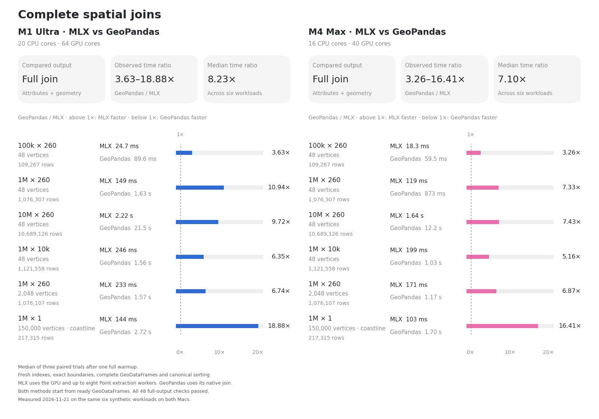
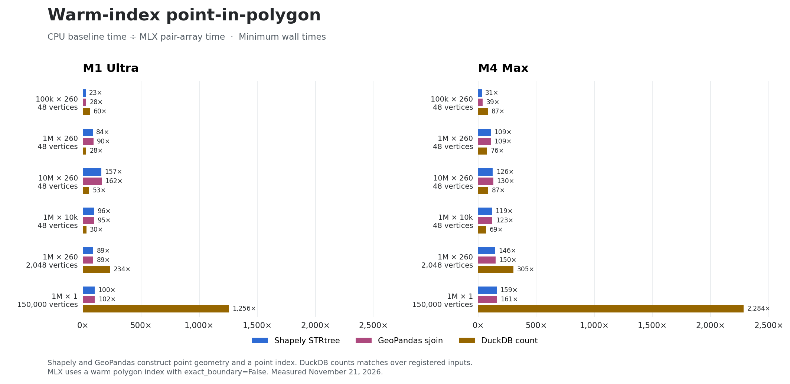

# mlx-geospatial

Fast point-in-polygon queries, spatial joins, and great-circle distances on
Apple silicon, powered by [MLX](https://github.com/ml-explore/mlx).

Use it to assign GPS points to zones, find nearby places, or build spatial
features for an MLX model. It accepts NumPy and Shapely data and can keep
query results as MLX arrays for further GPU processing.

## Install

```bash
pip install mlx-geospatial
```

Requires an Apple silicon Mac, Python 3.10+, and MLX 0.32.0+.
NumPy and Shapely are installed automatically. For GeoPandas support:

```bash
pip install "mlx-geospatial[geo]"
```

Install this checkout with `pip install ".[geo]"` for the prepared APIs and
the implementation measured below.

## Quickstart

Find which polygon contains each point:

```python
import numpy as np
from shapely.geometry import box
import mlx_geospatial as ms

# Coordinates are (longitude, latitude). Keep host coordinates in float64.
points = np.array([
    [-74.00, 40.72],
    [-73.98, 40.75],
    [-73.90, 40.80],
])
zones = [
    box(-74.02, 40.70, -73.99, 40.74),
    box(-74.00, 40.73, -73.96, 40.78),
]

labels = ms.point_in_polygon(points, zones)
print(labels)  # [ 0  1 -1]
```

Each label is a polygon's position in `zones`; `-1` means no match.
If polygons overlap, the lowest polygon index wins. To get every match:

```python
point_ids, polygon_ids = ms.point_in_polygon(points, zones, all_matches=True)
```

Containment returns NumPy arrays for host inputs and MLX arrays for MLX inputs.
Points very close to polygon edges need extra care; see [accuracy](#accuracy-and-limits).

### Reuse polygons and points

Build the polygon set and index once when querying the same zones repeatedly:

```python
polygons = ms.PolygonSet(zones)
index = ms.GridIndex(polygons)
labels = index.query(points)  # NumPy result
```

For an MLX pipeline, prepare the points once too. `to_local` shifts them to
the polygons' local coordinate system before converting to float32, preserving
more precision than casting raw longitude and latitude directly.

```python
import mlx.core as mx

local = polygons.to_local(points)
labels_mx = index.query(local)  # MLX result; local[:batch_size] works too
mx.eval(labels_mx)
```

These results can feed MLX operations directly. The
[feature pipeline example](https://github.com/tabulai/mlx-geospatial/blob/main/examples/mlx_feature_pipeline.py)
combines zone embeddings and distance features in a small neural network.

### Distances and nearest neighbors

Haversine functions take `(longitude, latitude)` in degrees and return meters
as MLX arrays. Use `degrees=False` for radians.

```python
landmarks = np.array([
    [-73.9857, 40.7484],
    [-74.0445, 40.6892],
])

distance = ms.haversine(points[0], points[1])            # one distance
matrix = ms.haversine_cross(points, landmarks)           # shape (3, 2)
distances, indices = ms.haversine_knn(points, landmarks, k=1)  # shape (3, 1) each
```

Keep the original coordinates for these functions: `LocalPoints` are shifted
coordinates and cannot be used for distances.
For repeated searches against fixed landmarks, build
`ms.HaversineReference(landmarks)` once and pass it to `haversine_knn`.

## End-to-end spatial join performance

In the November 21, 2026 runs, MLX was **3.63–18.88× faster on M1 Ultra**
and **3.26–16.41× faster on M4 Max** than native GeoPandas across six
synthetic point-in-polygon workloads. The median of the six ratios was
**8.23×** and **7.10×**, respectively.

The times are medians of three paired trials after a full warmup. Both
methods start with ready GeoDataFrames. The timers include fresh indexes,
exact boundaries, all matches, complete joined GeoDataFrames, and sorting.
The MLX measurement uses the frozen `GridIndex.query` and assembly adapter.

| Points × polygons | Vertices | M1 Ultra MLX | M1 Ultra GeoPandas | Speedup | M4 Max MLX | M4 Max GeoPandas | Speedup |
|---|---:|---:|---:|---:|---:|---:|---:|
| 100k × 260 | 48 | 24.7 ms | 89.6 ms | **3.63×** | 18.3 ms | 59.5 ms | **3.26×** |
| 1M × 260 | 48 | 149 ms | 1.63 s | **10.94×** | 119 ms | 873 ms | **7.33×** |
| 10M × 260 | 48 | 2.22 s | 21.54 s | **9.72×** | 1.64 s | 12.18 s | **7.43×** |
| 1M × 10k | 48 | 246 ms | 1.56 s | **6.35×** | 199 ms | 1.03 s | **5.16×** |
| 1M × 260 | 2,048 | 233 ms | 1.57 s | **6.74×** | 171 ms | 1.17 s | **6.87×** |
| 1M × 1 | 150,000 | 144 ms | 2.72 s | **18.88×** | 103 ms | 1.70 s | **16.41×** |



All **48 full-output checks** passed, including row order, attributes,
indexes, dtypes, geometry, and CRS. Both Macs passed **825 tests** with the
CI Metal validation settings and skipped one pandas-version-specific test.
The published data identifies the exact source revision and includes
individual trial samples and reproduction commands. [Benchmark guide](bench/README.md) ·
[Source and measurements](bench/results/2026-11-21-cold-edge/)

### Cold edge-index routing

The cutoff now weighs the candidate-edge work of the query against the
cost of indexing the whole layer. In the public first-match benchmark
with 65,536 points and 260 zones of 2,048 vertices each, the median fell
from **32.69 ms to 1.78 ms on M1 Ultra** and from **24.00 ms to
1.23 ms on M4 Max**. Each trial starts with an existing polygon set and
grid and a cold edge cache. [Cold-query chart](bench/results/2026-11-21-cold-edge/cold-edge-routing.png) ·
[Before-and-after results](bench/results/2026-11-21-cold-edge/comparison.json)

## Warm-index point-in-polygon benchmarks

These component benchmarks reuse the MLX polygon index and report **minimum
wall times** with `exact_boundary=False`. Each ratio compares a CPU baseline
with MLX on the same machine; both panels use a **0–2,500× linear scale**.

[](bench/results/2026-11-21-cold-edge/pip-m1-m4-side-by-side.png)

MLX and Shapely return pair arrays, GeoPandas returns a joined frame, and
DuckDB returns a count. Each ratio uses its method's timed setup and output.
[Component tables](bench/results/2026-11-21-cold-edge/COMPONENTS.md) ·
[Editable SVG](bench/results/2026-11-21-cold-edge/pip-m1-m4-side-by-side.svg) ·
[Historical measurements](bench/HISTORICAL.md)

## API at a glance

| API | Result |
| :--- | :--- |
| `point_in_polygon(points, polygons)` | One polygon index per point; `all_matches=True` returns every pair |
| `contains_matrix(points, polygons)` | Dense boolean matrix of shape `(points, polygons)` |
| `sjoin(points_df, polygons_df)` | Joined DataFrame; `all_matches=True` returns every matching polygon |
| `PreparedJoin(polygons_df)` | Reusable right-hand polygon table for repeated `sjoin` calls |
| `haversine(a, b)` | Elementwise or broadcast great-circle distances |
| `haversine_cross(a, b)` | All-pairs distance matrix |
| `haversine_knn(queries, references, k)` | Nearest distances and reference indices |
| `HaversineReference(references)` | Reusable GPU reference set for repeated `haversine_knn` searches |
| `PolygonSet(geometries)` | Polygons prepared for reuse; `to_local(points)` prepares query points |
| `GridIndex(polygons)` | Reusable spatial index; call `query(points)` |

`sjoin` supports `how="inner"` and `how="left"` and preserves a GeoDataFrame
input's geometry and CRS. By default, each point gets at most one match (the
first polygon in right-row order). For overlapping polygons, request every
match directly, with the right table's attributes and their original dtypes:

```python
joined = ms.sjoin(
    points_df, polygons_df,
    how="left", all_matches=True, predicate="within", exact_boundary=True,
)
```

An inner join returns matching pairs; a left join also keeps each unmatched
point once. The left index and right index labels are retained, including
duplicate labels, and right attributes come from each matched polygon row.
Pass `ms.PreparedJoin(polygons_df)` as the right argument to reuse that
polygon layer across batches.

## Accuracy and limits

- **Polygon edges:** containment uses float32 in local coordinates. Points
  inside a narrow tolerance band around an edge may fall on either side.
  Use `exact_boundary=True` with host inputs in `point_in_polygon`,
  `GridIndex.query`, or `sjoin` when exact Shapely boundary behavior matters.
  A conservative GPU filter narrows the CPU boundary checks where supported;
  detailed rings use cached edge bands for GPU work, while a float64 host
  edge grid narrows the remaining boundary checks. Suitable detailed
  single-ring polygons use prepared GEOS refinement.
  Exact handling still adds host work and synchronization.
- **Input precision:** prefer float64 NumPy coordinates or prepare them with
  `PolygonSet.to_local`. Raw float32 MLX coordinates may already have lost
  precision; queries emit `PrecisionWarning`.
- **Coordinates:** containment is planar and accepts coordinates in a shared
  coordinate system. Haversine uses a spherical Earth model. The library
  does not reproject data; it checks for a CRS mismatch when both inputs
  carry CRS metadata.
- **Scope:** supports points against polygons, including holes and
  multipolygons. It does not provide polygon overlays or polygon-to-polygon
  predicates. Use `PolygonSet(zones, validate=True)` to reject invalid geometry.
- **Workload matters:** small host queries can use the CPU automatically.
  Join performance depends on candidate counts, edge-band overlap and output
  size, as well as vertex count. A prebuilt BallTree can be faster for
  nearest-neighbor queries against large reference sets.
  Dense distance matrices and all-match outputs still need memory for their
  results.

The [usage guide](https://github.com/tabulai/mlx-geospatial/blob/main/docs/USAGE.md)
covers boundary predicates, precision, output types, backend selection, and
the remaining API helpers.
[Design notes](https://github.com/tabulai/mlx-geospatial/blob/main/docs/DESIGN.md)
describe the implementation.

## License

[MIT](https://github.com/tabulai/mlx-geospatial/blob/main/LICENSE)
