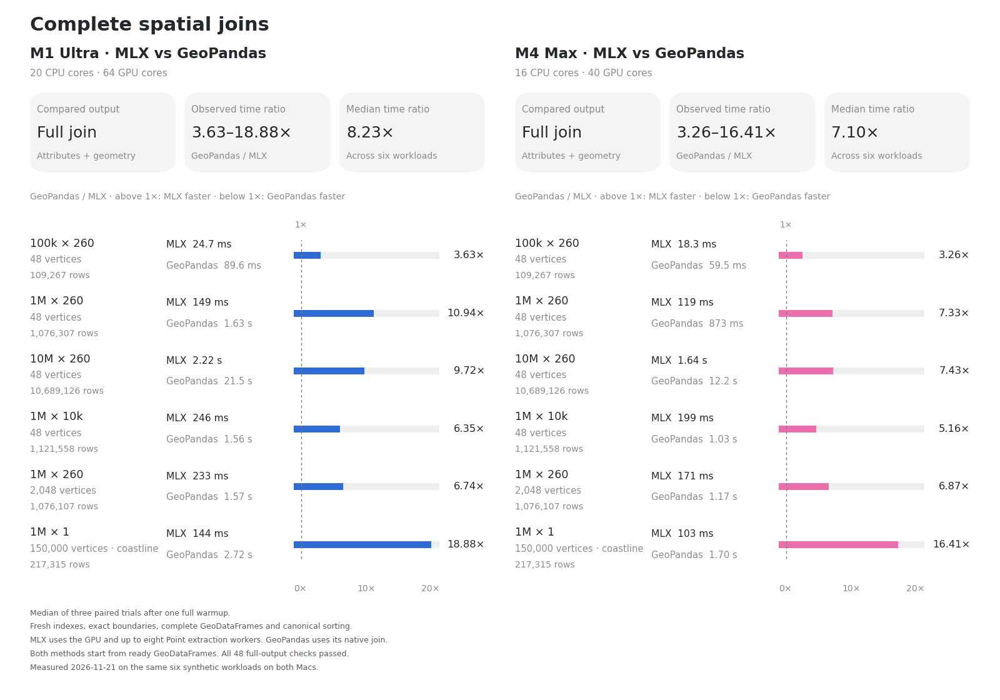
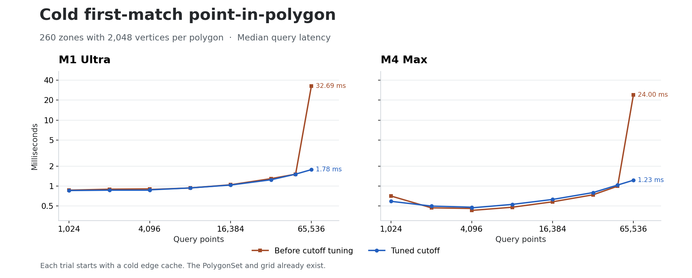

# Spatial-join benchmarks

The primary comparison measures **exact point-in-polygon joins from ready
GeoDataFrames to complete joined GeoDataFrames**, including fresh index
construction. Both implementations return every matching point–polygon pair,
with the same attributes, point geometry, index labels, dtypes, CRS, and row
order. The measurements cover six synthetic workloads on an M1 Ultra
and an M4 Max, recorded on **November 21, 2026**. Both hosts imported the
same repository source. [Source manifest](results/2026-11-21-cold-edge/source-manifest.json)

## Current results

MLX completed all six joins faster than GeoPandas on each machine.
Speedups ranged from **3.63–18.88× on M1 Ultra** (median **8.23×**) and
**3.26–16.41× on M4 Max** (median **7.10×**).



| Points × polygons | Vertices | M1 Ultra MLX | M1 Ultra GeoPandas | Speedup | M4 Max MLX | M4 Max GeoPandas | Speedup |
|---|---:|---:|---:|---:|---:|---:|---:|
| 100k × 260 | 48 | 24.7 ms | 89.6 ms | **3.63×** | 18.3 ms | 59.5 ms | **3.26×** |
| 1M × 260 | 48 | 149 ms | 1.63 s | **10.94×** | 119 ms | 873 ms | **7.33×** |
| 10M × 260 | 48 | 2.22 s | 21.54 s | **9.72×** | 1.64 s | 12.18 s | **7.43×** |
| 1M × 10k | 48 | 246 ms | 1.56 s | **6.35×** | 199 ms | 1.03 s | **5.16×** |
| 1M × 260 | 2,048 | 233 ms | 1.57 s | **6.74×** | 171 ms | 1.17 s | **6.87×** |
| 1M × 1 | 150,000 | 144 ms | 2.72 s | **18.88×** | 103 ms | 1.70 s | **16.41×** |

Each speedup is the GeoPandas median divided by the MLX median on the same
machine. Medians across workloads are descriptive summaries of these six
ratios, not a prediction for another dataset. Elapsed times use seconds
or milliseconds; output counts and geometry complexity differ by workload.

The charts and tables use the same unrounded medians. JSON includes the
individual trial samples. [JSON](results/2026-11-21-cold-edge/e2e-comparison.json) ·
[CSV](results/2026-11-21-cold-edge/e2e-comparison.csv) ·
[Overview SVG](results/2026-11-21-cold-edge/full-e2e-overview.svg) ·
[M1 Ultra chart](results/2026-11-21-cold-edge/full-e2e-m1.png) ·
[M4 Max chart](results/2026-11-21-cold-edge/full-e2e-m4.png)

Relative to the pre-tuning runs on the same host, complete-join MLX medians
changed by −13.6% to +14.6% on M1 Ultra and −4.6% to +8.5% on M4 Max.
Those full runs were timed in separate sessions. The alternating M4 Max
coastline follow-up measured 90.0 ms before and 91.5 ms after.
[Before-and-after results](results/2026-11-21-cold-edge/comparison.json)

## What is measured

Both methods start with equivalent, already constructed point and polygon
GeoDataFrames, with no cached spatial indexes or prepared polygon state.
The operation is an **inner join with `predicate="within"`**: boundary points
are excluded and overlaps produce multiple rows.

- **MLX:** construct a fresh `PolygonSet` and `GridIndex`; extract the host
  point coordinates; perform `query(..., backend="gpu", all_matches=True,
  predicate="within", exact_boundary=True)`; materialize every matching pair;
  attach all left and right nongeometry attributes to a point GeoDataFrame.
  Index construction includes the shared edge-band index where the query uses
  it. Exact float64 boundary checks and GEOS refinement are included.
- **GeoPandas:** call native `geopandas.sjoin(left, right, how="inner",
  predicate="within")`. GeoPandas implements this as polygon `contains`
  queries against a newly built point index, allowing GEOS to use its prepared
  polygon path. There is no Python partitioning or multiprocessing.
- **Both:** fully materialize the result and sort by point ID, then right
  index label, inside the timer. Each timed call uses fresh input copies and
  indexes; native prepared polygon state is cleared before every call.

The MLX measurement uses a frozen adapter that calls `GridIndex.query`
and assembles the attributes. The public API suite times native
`ms.sjoin(..., all_matches=True)` separately. [Exact harness](e2e/run_e2e.py) ·
[Public API suite](bench_public_api.py)

Input GeoDataFrame construction and copying, synthetic data generation,
imports, runtime initialization, cold kernel compilation, validation, metadata
collection, and disk I/O are outside both timers. This is end to end **from
ready input frames**, not from CSV/Parquet or process startup. A full untimed
warmup runs for each method and workload, followed by **three measured paired
trials with alternating method order**. The reported statistic is the median
for each method, not its fastest observation.

These timings include host work as well as GPU work. They should not be read
as isolated GPU-kernel timings or compared directly with the historical warm
pair-array measurements.

## Inputs and correctness

The harness replays the original seed-0 generation sequence and verifies all
25 input fingerprints. Inputs use float64 coordinates near New York City in
EPSG:4326; the point-in-polygon operation is planar. The 48-vertex zones are
random star-shaped polygons that overlap and leave gaps.

The **2,048-vertex zones resample the exteriors of 48-vertex polygons** using
linear interpolation. They increase edge count without introducing thousands
of independent boundary features. The 150,000-vertex case is one synthetic
ring with low- and high-frequency radial undulations and noise. These are
controlled synthetic cases, not a representative sample of administrative
boundaries or real coastline datasets.

| Points × polygons | Vertices | Joined rows | Matched points | Unmatched points | Points with multiple matches |
|---|---:|---:|---:|---:|---:|
| 100k × 260 | 48 | 109,267 | 66,815 | 33,185 | 29,133 |
| 1M × 260 | 48 | 1,076,307 | 655,462 | 344,538 | 290,486 |
| 10M × 260 | 48 | 10,689,126 | 6,501,488 | 3,498,512 | 2,849,585 |
| 1M × 10k | 48 | 1,121,558 | 673,587 | 326,413 | 308,179 |
| 1M × 260 | 2,048 | 1,076,107 | 673,014 | 326,986 | 287,223 |
| 1M × 1 | 150,000 | 217,315 | 217,315 | 782,685 | 0 |

Each output contains the point ID, a float point value, point geometry, the
right index label, a zone ID, a string zone name, and a float zone weight.
Indexes are unique unnamed integer labels deliberately different from row
positions, and attribute names do not collide. This benchmark does not certify
all possible DataFrame schemas or join modes.

**All 48 paired full-output comparisons passed**: one warmup pair and three
measured pairs for each of six workloads on each host. Validation covers
every row, attribute, dtype, index label and order, geometry coordinate, active
geometry name, and CRS. Input fingerprints, output pair hashes, dependency
versions, and package source hashes match across machines. The
small boundary fixture also passed on both hosts.

The test suite passed **825 tests on each host** with the CI Metal flags and
skipped one pandas 2.2-specific test. Timings use the ordinary Metal runtime.
[Test logs and source evidence](results/2026-11-21-cold-edge/)

## Machines and runtime

| Machine | CPU cores | GPU cores | macOS |
|---|---:|---:|---|
| M1 Ultra | 20 | 64 | 26.5.1 |
| M4 Max | 16 | 40 | 26.6.2 |

Both hosts used Python 3.14.2, MLX 0.32.4, NumPy 2.5.4, pandas 3.0.6,
Shapely 2.2.0, and GeoPandas 1.2.0. The complete pinned environment is in
[requirements.txt](e2e/requirements.txt). Both ran on AC power with sleep
inhibited. Numerical-library thread limits were set to one. MLX Point coordinate
extraction independently uses **up to eight host worker threads** (three
for the 100k-point case, eight for the larger cases), and MLX can use the
whole GPU. GeoPandas/GEOS uses its native spatial join without parallel
partitioning. macOS versions and machine background activity differed. Load and memory snapshots are
recorded in each raw result file.

## Reproduce the spatial joins

Use an Apple silicon Mac with Python 3.14.2. From the repository root,
install the pinned dependencies and extract the measured revision.
The commands below select that source with `PYTHONPATH`.

```bash
python3.14 -m venv .venv-e2e
source .venv-e2e/bin/activate
python -m pip install -r bench/e2e/requirements.txt
BENCH_SOURCE=$(mktemp -d /tmp/mlx-geospatial-source.XXXXXX)
git archive 92a87cee33b48df78710506216320bde64027175 | tar -x -C "$BENCH_SOURCE"
```

The following runs all six workloads. Set a descriptive machine label and
use a **new output directory for every run**; the harness refuses to overwrite
an existing `e2e-results.json`.

```bash
E2E_OUTPUT=$(mktemp -d /tmp/mlx-geospatial-e2e.XXXXXX)
env -u MTL_DEBUG_LAYER -u MTL_SHADER_VALIDATION \
  -u METAL_DEVICE_WRAPPER_TYPE -u METAL_DEBUG_ERROR_MODE -u MLX_METAL_DEBUG \
  -u MLX_GEOSPATIAL_BACKEND \
  PYTHONPATH="$BENCH_SOURCE" \
  OMP_NUM_THREADS=1 OPENBLAS_NUM_THREADS=1 VECLIB_MAXIMUM_THREADS=1 \
  MKL_NUM_THREADS=1 NUMEXPR_NUM_THREADS=1 \
  caffeinate -dimsu python "$BENCH_SOURCE/bench/e2e/run_e2e.py" \
  --output "$E2E_OUTPUT" --machine-label "My Apple silicon Mac" \
  --reference-json "$BENCH_SOURCE/bench/e2e/reference-benchmark-results.json"
```

Add `--smoke-only` for the small correctness fixture or `--cases 4` for the
2,048-vertex workload, each with its own fresh output directory. The small
fixture covers overlaps, holes, unmatched points, exact boundary points, and
points immediately on either side of an edge. Partial runs still replay the
input sequence so their selected workload matches the full run.

Run the same command on the second host with the same checkout and pinned
environment. Compare package module hashes, input fingerprints, protocol,
dependency versions, and output pair hashes before comparing elapsed times.
The [raw M1 result](results/2026-11-21-cold-edge/m1/e2e-results.json) and
[raw M4 result](results/2026-11-21-cold-edge/m4/e2e-results.json) show the recorded
metadata and individual trials for this report.

The unchanged runner imports the adjacent frozen `bench.py` and
`run_benchmarks.py`; use the complete [bench/e2e directory](e2e/) to reproduce
this study. The top-level `bench/bench.py` is a separate array-operation
harness and is not a substitute for these inputs or timing boundaries.
[Analysis and chart sources](results/2026-11-21-cold-edge/) are stored alongside
the measurements so the tables and figures remain inspectable and reproducible.

## Other benchmarks and earlier results

The latest component runs cover all-pair arrays, first-match host and device
queries, cold queries, haversine matrices, four kNN shapes, dense PIP and
144 CPU/GPU/auto crossover timings per Mac. The report gives the minimum
wall times and includes separate BallTree build-plus-query and prebuilt-tree
timings. [Component tables](results/2026-11-21-cold-edge/COMPONENTS.md)

To reproduce the recorded sweep, run the top-level array harness through
the recorder in the pinned environment above. The recorder loads the
adjacent `bench.py`.

```bash
COMPONENT_OUTPUT=$(mktemp -d /tmp/mlx-geospatial-components.XXXXXX)
COMPONENT_DRIVER=$(mktemp -d /tmp/mlx-geospatial-driver.XXXXXX)
cp "$BENCH_SOURCE/bench/bench.py" "$BENCH_SOURCE/bench/e2e/run_benchmarks.py" "$COMPONENT_DRIVER/"
env -u MTL_DEBUG_LAYER -u MTL_SHADER_VALIDATION \
  -u METAL_DEVICE_WRAPPER_TYPE -u METAL_DEBUG_ERROR_MODE -u MLX_METAL_DEBUG \
  -u MLX_GEOSPATIAL_BACKEND \
  PYTHONPATH="$BENCH_SOURCE" \
  OMP_NUM_THREADS=1 OPENBLAS_NUM_THREADS=1 VECLIB_MAXIMUM_THREADS=1 \
  MKL_NUM_THREADS=1 NUMEXPR_NUM_THREADS=1 \
  caffeinate -dimsu python "$COMPONENT_DRIVER/run_benchmarks.py" \
  --output "$COMPONENT_OUTPUT" --machine-label "My Apple silicon Mac" \
  > "$COMPONENT_OUTPUT/benchmark.log" 2>&1
```

The full sweep replays the reference input sequence; individual `--op`
commands below start the random generator at a different position.

The [October release benchmarks](results/2026-10-19-opus-speedups/) and
[historical measurements](HISTORICAL.md) preserve their original runtime,
output, precision and index-reuse contracts.

Use the separate array harness for new component measurements:

```bash
python bench/bench.py --all
python bench/bench.py --op haversine --n 20000 --m 20000
python bench/bench.py --op knn --n 1000 --m 1000000 --k 10
python bench/bench.py --op dense-pip --n 100000 --m 32 --vertices 48
python bench/bench.py --op crossover --m 260
```

The dense-PIP mode is a kernel microbenchmark with pre-ingested polygons and
device-resident points. Crossover measurements concern the library's own
float32 NumPy fallback versus its GPU route, not GeoPandas. BallTree results
must distinguish tree construction plus query from querying an existing tree.

## Public API benchmarks

Run `python bench/bench_public_api.py` for native `sjoin`, `PreparedJoin`,
`HaversineReference`, detailed-polygon first-match routing, and all-match
batching. It reports median query times, separates preparation from repeat
queries, and verifies complete spatial join outputs and prepared kNN results
outside the timers. The detailed-polygon cold timings include an edge-index
build when dispatch triggers one. Use `--raw-only` with v0.1.1 to measure
the same inputs through the APIs available in that release.

### Cold edge-index routing



In the public first-match sweep, 65,536 points against 260 zones of 2,048
vertices each went from **32.69 ms to 1.78 ms on M1 Ultra** and **24.00 ms
to 1.23 ms on M4 Max**. The two builds were measured in separate sessions.
Each query starts with a polygon set and grid already built and an empty
edge cache.

The paired dispatch sweep alternated the two revisions on the same inputs.
All 96 cases per Mac returned identical results. Among the 36 cases where
the build decision changed, median speedups were **1.83× on M1 Ultra** and
**2.14× on M4 Max**. The M1 all-match case with 262,144 points and 260
4,096-vertex zones increased from 65.9 ms to 72.6 ms.
[M1 paired samples](results/2026-11-21-cold-edge/m1/cold-dispatch-ab.jsonl) ·
[M4 paired samples](results/2026-11-21-cold-edge/m4/cold-dispatch-ab.jsonl) ·
[Chart SVG](results/2026-11-21-cold-edge/cold-edge-routing.svg)
