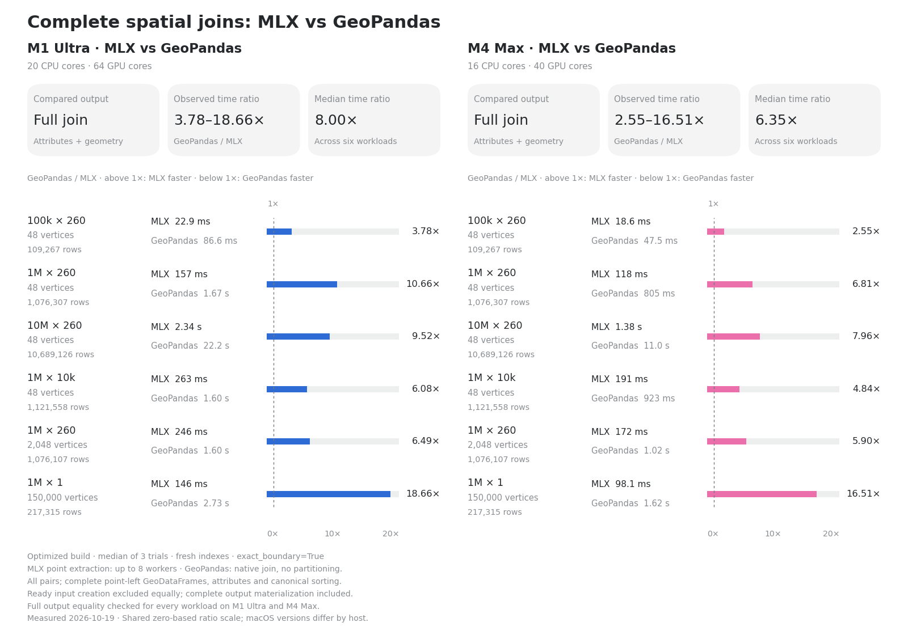

# Spatial-join benchmarks

The primary comparison measures **exact point-in-polygon joins from ready
GeoDataFrames to complete joined GeoDataFrames**, including fresh index
construction. Both implementations return every matching point–polygon pair,
with the same attributes, point geometry, index labels, dtypes, CRS, and row
order. The measurements below cover six synthetic workloads on an M1 Ultra
and an M4 Max, recorded on **2026-10-19**.

These results describe the source build of commit `8805228`; version **0.1.1**
includes its optimizations. The identical measured wheel was installed on both hosts;
its source hashes and build information are preserved in the
[build manifest](results/2026-10-19-opus-speedups/build-manifest.json).

## Current results

MLX completed all six joins faster than GeoPandas on each machine:
**3.78–18.66× on M1 Ultra** (median ratio **8.00×**) and
**2.55–16.51× on M4 Max** (median ratio **6.35×**). The M4 Max
completed the MLX joins **1.23–1.69× faster** than the M1 Ultra.
These are complete new runs of all six workloads on commit `8805228`;
no rows are carried over from earlier optimization studies.

The latest build adds threaded Point extraction, a host float64 edge grid,
and polygon-major GEOS refinement. Relative to the preceding complete run,
MLX medians improved **1.16–1.95× on M1 Ultra** and **1.20–1.97× on M4 Max**.
The [prior/current table](results/2026-10-19-opus-speedups/tables.md)
compares identical inputs and runtime versions in separate sessions;
these differences can also reflect background activity.



| Points × polygons | Vertices | M1 Ultra MLX | M1 Ultra GeoPandas | Speedup | M4 Max MLX | M4 Max GeoPandas | Speedup |
|---|---:|---:|---:|---:|---:|---:|---:|
| 100k × 260 | 48 | 22.9 ms | 86.6 ms | **3.78×** | 18.6 ms | 47.5 ms | **2.55×** |
| 1M × 260 | 48 | 157 ms | 1.67 s | **10.66×** | 118 ms | 805 ms | **6.81×** |
| 10M × 260 | 48 | 2.34 s | 22.23 s | **9.52×** | 1.38 s | 11.02 s | **7.96×** |
| 1M × 10k | 48 | 263 ms | 1.60 s | **6.08×** | 191 ms | 923 ms | **4.84×** |
| 1M × 260 | 2,048 | 246 ms | 1.60 s | **6.49×** | 172 ms | 1.02 s | **5.90×** |
| 1M × 1 | 150,000 | 146 ms | 2.73 s | **18.66×** | 98.1 ms | 1.62 s | **16.51×** |

Each speedup is the GeoPandas median divided by the MLX median on the same
machine. Medians across workloads are descriptive summaries of these six
ratios, not a prediction for another dataset. Elapsed times use seconds
or milliseconds; output counts and geometry complexity differ by workload.

The charts and tables come from the same unrounded
[JSON results](results/2026-10-19-opus-speedups/comparison.json) and
[CSV results](results/2026-10-19-opus-speedups/comparison.csv). Individual trial
samples are retained in JSON; both formats retain minimum/maximum ranges. Download the
[overview SVG](results/2026-10-19-opus-speedups/full-e2e-overview.svg),
[M1 Ultra chart](results/2026-10-19-opus-speedups/full-e2e-m1.png), or
[M4 Max chart](results/2026-10-19-opus-speedups/full-e2e-m4.png).

## What is measured

Both methods start with equivalent, already constructed point and polygon
GeoDataFrames, with no cached spatial indexes or prepared polygon state.
The operation is an **inner join with `predicate="within"`**: boundary points
are excluded and overlaps produce multiple rows.

- **MLX:** construct a fresh `PolygonSet` and `GridIndex`; extract the host
  point coordinates; perform `query(..., backend="gpu", all_matches=True,
  predicate="within", exact_boundary=True)`; materialize every matching pair;
  attach all left and right nongeometry attributes to a point GeoDataFrame.
  Index construction includes the shared edge-band index where the query uses
  it. Exact float64 boundary checks and GEOS refinement are included.
- **GeoPandas:** call native `geopandas.sjoin(left, right, how="inner",
  predicate="within")`. GeoPandas implements this as polygon `contains`
  queries against a newly built point index, allowing GEOS to use its prepared
  polygon path. There is no Python partitioning or multiprocessing.
- **Both:** fully materialize the result and sort by point ID, then right
  index label, inside the timer. Each timed call uses fresh input copies and
  indexes; native prepared polygon state is cleared before every call.

The MLX measurement uses the frozen **query-plus-attribute-assembly adapter**
in [the harness](e2e/run_e2e.py). It does not time native `ms.sjoin`.
`ms.sjoin(..., all_matches=True)` is a supported public API tested separately;
keeping the adapter unchanged preserves comparability across the optimization
studies.

Input GeoDataFrame construction and copying, synthetic data generation,
imports, runtime initialization, cold kernel compilation, validation, metadata
collection, and disk I/O are outside both timers. This is end to end **from
ready input frames**, not from CSV/Parquet or process startup. A full untimed
warmup runs for each method and workload, followed by **three measured paired
trials with alternating method order**. The reported statistic is the median
for each method, not its fastest observation.

These timings include host work as well as GPU work. They should not be read
as isolated GPU-kernel timings or compared directly with the historical warm
pair-array measurements.

## Inputs and correctness

The harness replays the original seed-0 generation sequence and verifies all
25 input fingerprints. Inputs use float64 coordinates near New York City in
EPSG:4326; the point-in-polygon operation is planar. The 48-vertex zones are
random star-shaped polygons that overlap and leave gaps.

The **2,048-vertex zones resample the exteriors of 48-vertex polygons** using
linear interpolation. They increase edge count without introducing thousands
of independent boundary features. The 150,000-vertex case is one synthetic
ring with low- and high-frequency radial undulations and noise. These are
controlled synthetic cases, not a representative sample of administrative
boundaries or real coastline datasets.

| Points × polygons | Vertices | Joined rows | Matched points | Unmatched points | Points with multiple matches |
|---|---:|---:|---:|---:|---:|
| 100k × 260 | 48 | 109,267 | 66,815 | 33,185 | 29,133 |
| 1M × 260 | 48 | 1,076,307 | 655,462 | 344,538 | 290,486 |
| 10M × 260 | 48 | 10,689,126 | 6,501,488 | 3,498,512 | 2,849,585 |
| 1M × 10k | 48 | 1,121,558 | 673,587 | 326,413 | 308,179 |
| 1M × 260 | 2,048 | 1,076,107 | 673,014 | 326,986 | 287,223 |
| 1M × 1 | 150,000 | 217,315 | 217,315 | 782,685 | 0 |

Each output contains the point ID, a float point value, point geometry, the
right index label, a zone ID, a string zone name, and a float zone weight.
Indexes are unique unnamed integer labels deliberately different from row
positions, and attribute names do not collide. This benchmark does not certify
all possible DataFrame schemas or join modes.

**All 48 paired full-output comparisons passed**: one warmup pair and three
measured pairs for each of six workloads on each host. Validation covers
every row, attribute, dtype, index label and order, geometry coordinate, active
geometry name, and CRS. Input fingerprints, output pair hashes, dependency
versions, and installed package source hashes match across machines. The
small boundary fixture also passed on both hosts.

A fresh full test suite passed **721 tests on each host with Metal validation
enabled**, using the identical archived source from which the measured wheel
was built. Metal validation is disabled for timing. Fresh test logs, benchmark
logs and source identity are retained with [the result files](results/2026-10-19-opus-speedups/).

## Machines and runtime

| Machine | CPU cores | GPU cores | macOS |
|---|---:|---:|---|
| M1 Ultra | 20 | 64 | 26.5.1 |
| M4 Max | 16 | 40 | 26.6.2 |

Both hosts used Python 3.14.2, MLX 0.32.4, NumPy 2.5.4, pandas 3.0.6,
Shapely 2.2.0, and GeoPandas 1.2.0. The complete pinned environment is in
[requirements.txt](e2e/requirements.txt). Both ran on AC power with sleep
inhibited. Numerical-library thread limits were set to one. MLX Point coordinate
extraction independently uses **up to eight host worker threads** (three
for the 100k-point case, eight for the larger cases), and MLX can use the
whole GPU. GeoPandas/GEOS uses its native spatial join without parallel
partitioning. macOS versions and machine background activity differed. Load and memory snapshots are
recorded in each raw result file.

## Reproduce the spatial joins

Use an Apple silicon Mac with Python 3.14.2. From the repository root, create
an environment with the pinned dependencies and install a clean archive of
the measured commit. A clean source directory keeps stale build files out
of the installed wheel:

```bash
python3.14 -m venv .venv-e2e
source .venv-e2e/bin/activate
python -m pip install -r bench/e2e/requirements.txt
BENCH_SOURCE=$(mktemp -d /tmp/mlx-geospatial-source.XXXXXX)
git archive 880522855606458869052d6ff069fbd1cbb53d1a | tar -x -C "$BENCH_SOURCE"
python -m pip install --no-deps "$BENCH_SOURCE"
```

The following runs all six workloads. Set a descriptive machine label and
use a **new output directory for every run**; the harness refuses to overwrite
an existing `e2e-results.json`.

```bash
E2E_OUTPUT=$(mktemp -d /tmp/mlx-geospatial-e2e.XXXXXX)
env -u MTL_DEBUG_LAYER -u MTL_SHADER_VALIDATION \
  -u METAL_DEVICE_WRAPPER_TYPE -u METAL_DEBUG_ERROR_MODE -u MLX_METAL_DEBUG \
  -u MLX_GEOSPATIAL_BACKEND \
  OMP_NUM_THREADS=1 OPENBLAS_NUM_THREADS=1 VECLIB_MAXIMUM_THREADS=1 \
  MKL_NUM_THREADS=1 NUMEXPR_NUM_THREADS=1 \
  caffeinate -dimsu python bench/e2e/run_e2e.py \
  --output "$E2E_OUTPUT" --machine-label "My Apple silicon Mac" \
  --reference-json bench/e2e/reference-benchmark-results.json
```

Add `--smoke-only` for the small correctness fixture or `--cases 4` for the
2,048-vertex workload, each with its own fresh output directory. The small
fixture covers overlaps, holes, unmatched points, exact boundary points, and
points immediately on either side of an edge. Partial runs still replay the
input sequence so their selected workload matches the full run.

Run the same command on the second host with the same checkout and pinned
environment. Compare package module hashes, input fingerprints, protocol,
dependency versions, and output pair hashes before comparing elapsed times.
The [raw M1 result](results/2026-10-19-opus-speedups/m1/e2e-results.json) and
[raw M4 result](results/2026-10-19-opus-speedups/m4/e2e-results.json) show the recorded
metadata and individual trials for this report.

The unchanged runner imports the adjacent frozen `bench.py` and
`run_benchmarks.py`; use the complete [bench/e2e directory](e2e/) to reproduce
this study. The top-level `bench/bench.py` is a separate array-operation
harness and is not a substitute for these inputs or timing boundaries.
[Analysis and chart sources](results/2026-10-19-opus-speedups/) are stored alongside
the measurements so the tables and figures remain inspectable and reproducible.

## Other benchmarks and earlier results

The [current component report](results/2026-10-19-opus-speedups/COMPONENTS.md)
refreshes every component table on the same source and both machines:
all-pair arrays, first-match host/device queries, cold queries, haversine
matrices, four kNN shapes, dense PIP and CPU/GPU crossover. Its raw samples,
JSON and CSV are retained alongside the tables. Component timings use the
frozen best-of protocol, not the paired E2E medians above.

Across the four `k=10` shapes, MLX kNN times improved **1.73–5.98× on M1
Ultra** and **3.31–8.19× on M4 Max** versus the prior matched component
runs. These are comparisons between separate sessions. The report retains
both BallTree build-plus-query and prebuilt-tree timings: the prebuilt tree
still narrowly wins the 1k-query × 1M-reference case on M4 Max.

To reproduce the recorded component sweep with structured samples and the
console evidence needed for the crossover tables, use the same installed
build and pinned environment as above:

```bash
COMPONENT_OUTPUT=$(mktemp -d /tmp/mlx-geospatial-components.XXXXXX)
env -u MTL_DEBUG_LAYER -u MTL_SHADER_VALIDATION \
  -u METAL_DEVICE_WRAPPER_TYPE -u METAL_DEBUG_ERROR_MODE -u MLX_METAL_DEBUG \
  -u MLX_GEOSPATIAL_BACKEND \
  OMP_NUM_THREADS=1 OPENBLAS_NUM_THREADS=1 VECLIB_MAXIMUM_THREADS=1 \
  MKL_NUM_THREADS=1 NUMEXPR_NUM_THREADS=1 \
  caffeinate -dimsu python bench/e2e/run_benchmarks.py \
  --output "$COMPONENT_OUTPUT" --machine-label "My Apple silicon Mac" \
  > "$COMPONENT_OUTPUT/benchmark.log" 2>&1
```

The full sweep replays the reference input sequence; individual `--op`
commands below start the random generator at a different position.

[Historical measurements](HISTORICAL.md) preserve the pre-release warm
point-in-polygon, first-match, CPU/GPU crossover, distance-matrix, and kNN
results, plus earlier optimization studies and the preceding complete E2E run.
They keep their original runtime, output, precision, and index-reuse caveats.
In particular, warm NumPy pair arrays are not complete GeoDataFrames, and the
distance comparison uses float32 MLX results versus float64 CPU results.

Use the separate array harness for new component measurements:

```bash
python bench/bench.py --all
python bench/bench.py --op haversine --n 20000 --m 20000
python bench/bench.py --op knn --n 1000 --m 1000000 --k 10
python bench/bench.py --op dense-pip --n 100000 --m 32 --vertices 48
python bench/bench.py --op crossover --m 260
```

The dense-PIP mode is a kernel microbenchmark with pre-ingested polygons and
device-resident points. Crossover measurements concern the library's own
float32 NumPy fallback versus its GPU route, not GeoPandas. BallTree results
must distinguish tree construction plus query from querying an existing tree.
